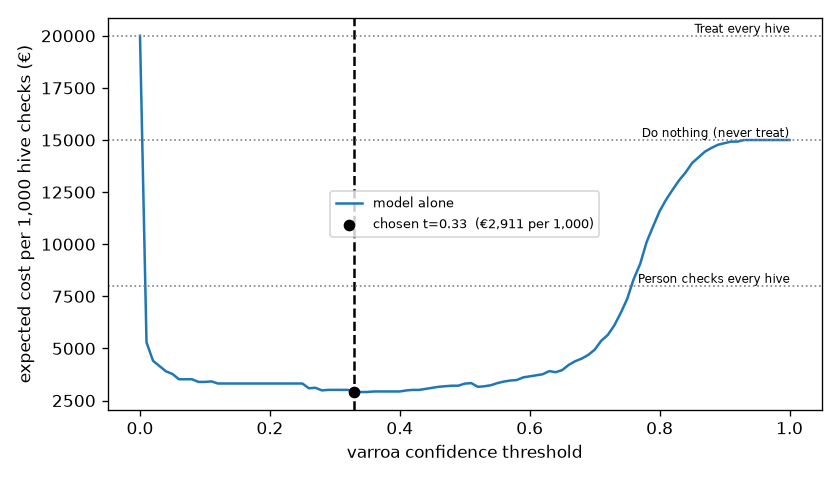

# Assignment 2 Report: Varroa mite screening for beehives

- **Name**: Marcela Carla Torrelledó Hoyos
- **Student ID**: 19356
- **Email**: mth.ieu2022@student.ie.edu
- **Group**: BBADBA 5A

## Business problem, and the cost of being wrong

**The decision.** A commercial beekeeper with ~400 hives has to decide, hive by hive, whether to treat against *Varroa destructor*, the parasitic mite behind most colony losses in Europe. Today the call is made by eye or by a manual "sugar roll" test, which takes 10–15 minutes per hive, so hives get checked rarely and infestations are often caught late. The model looks at a photo of the bees at the hive entrance and gives the beekeeper one of three answers: **leave the hive alone**, **treat it**, or **check it by hand**. The beekeeper acts on it. A case is one photo of one hive at one weekly check.

**What each mistake costs:**

| Outcome | € per hive check | Why |
|---|---|---|
| Miss an infested hive (FN) | **150** | Untreated, the mite load keeps growing until the next check. A weak or dead colony costs ~€150–250 to replace, plus the season's honey. I'm counting the *expected* loss of one more cycle untreated, not the full loss of the colony every time. |
| Treat a healthy hive (FP) | **20** | ~€10–15 of miticide plus ~10 min of labour. There are also hidden costs that I'm not pricing: it stresses the colony, and every unnecessary treatment helps mites build resistance. |
| Treat an infested hive (TP) | **20** | Same treatment, but money well spent. |
| Leave a healthy hive alone (TN) | 0 | Nothing happens. |
| Manual check by a person | **6** | ~12 min at ~€30/h. |

**The asymmetry.** A miss costs about **7.5 times** an unnecessary treatment (€150 vs €20). Measured as regret, it's €130 vs €20, about 6.5 times. That's why the whole analysis leans toward catching mites, even at the price of some extra treatments. It also tells me which metric matters: **varroa recall**, not overall accuracy.

**Base rate.** I assume **10%** of hive checks find a hive that really needs treatment. Infestation is seasonal: much lower in spring, higher in late summer. That's why I ran a sensitivity analysis from 2% to 40% instead of trusting a single number.

## Dataset

- **Roboflow Universe:** workspace `bee-9phqe`, project `beehive-qyqml`, **version 1**. Link: https://universe.roboflow.com/bee-9phqe/beehive-qyqml (CC BY 4.0, used as-is, not forked).
- **Task:** object detection. Two classes: `bee` and `varroa`.
- **One image:** a 640×640 photo of bees at or near the hive entrance, with a box around each bee and each visible mite.
- **Why it serves the decision:** the decision needs to know whether mites are present on the bees going in and out of a hive. That's exactly what this dataset labels.
- **Why version 1:** it has no augmentation, so the test images aren't edited copies of training images. It's also smaller (4,621 training images), which made training on my laptop feasible.

## What the dataset's composition implies

| Split | Images | Bee boxes | Varroa boxes | Images with ≥1 mite |
|---|---|---|---|---|
| Train | 4,621 | 6,067 | 12,122 | 77% |
| Val | 1,321 | 1,692 | 3,699 | 76% |
| Test | 660 | 693 | 1,722 | **78% (518 of 660)** |

Object size (relative to a 640×640 image):

| Class | Median box area | Median side | Share smaller than 32 px |
|---|---|---|---|
| Bee | 1.36% of the image | ~75 px | 3% |
| Varroa | **0.39% of the image** | **~40 px** | **31%** |

What I take from this:

1. **Mites are tiny.** A third of them are under 32 px, the size where detectors start to struggle. I expect most misses to be small mites, and that's where the model would gain most from higher-resolution photos.
2. **The bee class is under-labelled.** There are twice as many mite boxes as bee boxes, and only 26% of training images have any bee labelled. Many visible bees just aren't boxed. So when the model "invents" a bee, it's often a real bee nobody labelled. Bee precision will look worse than it really is, and I don't use the bee class for the decision.
3. **The test set is far more infested than reality.** 78% of test images have mites; I assume 10% in a real apiary. So I can't use the test set's raw accuracy or cost. I take the *rates* from the test set (how often an infested hive gets flagged, how often a healthy one does) and re-weight them with my own base rate.
4. **The healthy side is thin.** Only 142 test images have no mites. My false-alarm rate rests on a handful of cases (6 false alarms at my threshold), so one or two images either way move it a lot. Varroa recall, with 518 positive images and 1,722 mites, is much more solid.
5. **The images may not look like production.** They come from a few setups. A camera on a real hive entrance would add rain, bad light, motion blur and bees crowding the board, so I'd expect the real numbers to be somewhat worse.

## Finetuning and baselines

- **Model:** `yolo11n` (detection), fine-tuned from the COCO-pretrained checkpoint. I chose detection rather than classification because the mite is a tiny object on a larger bee. Detection keeps the location, which also lets a beekeeper see *where* the model thinks the mite is.
- **Training:** 15 epochs, 640 px, batch 16, AdamW (auto), seed 0, on my MacBook Air (Apple M1, MPS). It took about 3.3 h. I cut it from the planned 30 epochs because of laptop time. Validation mAP was still rising at epoch 15, so more epochs or a GPU would probably help.
- **Pipeline:** `uv run python main.py train` downloads the data, describes it, trains, evaluates and runs the cost sweep. `A2_SKIP_TRAIN=1` re-runs only the evaluation on the committed weights.

Results on the same 660-image test split:

| Model | mAP50 | mAP50-95 | Varroa AP50 | Varroa recall |
|---|---|---|---|---|
| **Fine-tuned yolo11n** | **0.83** | **0.48** | **0.90** | **0.88** |
| COCO yolo11n zero-shot | 0.01 | 0.00 | 0.00 | 0.00 |
| Trivial: predict nothing | 0.00 | 0.00 | 0.00 | 0.00 |

For the COCO baseline I was generous: every box it draws counts as "bee", because COCO has no bee or mite class. It still finds almost nothing (bee recall 4%), and it can't say "mite" at all. The gap is as big as I expected. The task needs a class the off-the-shelf model has never seen, so without fine-tuning there's no product.

## Per-class evaluation and failure modes

**Positive class: `varroa`.** It carries the headline number and the business decision.

| Class | Boxes | AP50 | AP50-95 | Precision @0.25 | Recall @0.25 |
|---|---|---|---|---|---|
| Varroa | 1,722 | **0.90** | 0.50 | 0.79 | **0.88** |
| Bee | 693 | 0.75 | 0.46 | 0.47 | 0.87 |

Box confusion matrix on the test split (confidence ≥ 0.25, IoU ≥ 0.5):

| True ↓ / Predicted → | Bee | Varroa | Nothing (missed) |
|---|---|---|---|
| Bee | 602 | 1 | 90 |
| Varroa | 1 | **1,523** | **198** |
| Background | 667 | 407 | – |

Where it breaks:

- **It never confuses a bee with a mite** (1 box each way). The errors are all about the background: it misses things that are there, or sees things that aren't.
- **Missed mites (198, 11.5%)** are mostly the smallest ones, which matches the size analysis.
- **False mites (407 boxes)** show up as small dark spots, likely pollen, shadows or bee body parts. Some may also be real mites missing from the labels.
- **Bee false positives (667)** are mostly unlabelled bees, as explained above. That's why bee precision (0.47) looks so poor, and why I don't use it.
- **At the hive level, both failure modes have a pattern:**
  - The 6 infested images the model misses all have mites but *no labelled bee*. These are mites not sitting on a bee, which the model is less sure about.
  - 5 of the 6 healthy images it wrongly flags show bees. Something on the bee looked like a mite.

## Cost matrix and operating point

**How a box becomes a decision.** The hive's score is the **highest varroa confidence** found in its photo. If the score is at or above the threshold, the hive gets treated.

**The sweep.** I tested every threshold from 0 to 1 in steps of 0.01. At each one I computed the expected cost per 1,000 hive checks at a 10% base rate, using the costs above. The **cheapest threshold is 0.33** (`artifacts/cost_curve.png`, also in the dashboard).

At 0.33 the model:

- catches **512 of 518** infested hives (recall 98.8%);
- wrongly flags **6 of 142** healthy hives (4.2%);
- costs **€2,911 per 1,000 checks**.

The threshold is fairly low because a miss is so much more expensive than a false alarm. Raising it to 0.65 halves the false alarms, but the misses jump from 6 to 68.

**Sensitivity: the assumption that matters most.** The two figures I'm least sure about are the cost of a miss and the base rate:

| Miss cost \ Base rate | 2% | 10% | 40% |
|---|---|---|---|
| €40 | 0.77 | 0.65 | 0.33 |
| €150 (mine) | 0.65 | **0.33** | 0.09 |
| €600 | 0.33 | 0.28 | 0.09 |

*Cheapest threshold in each scenario.*

- **The threshold moves a lot.** If misses are cheap and infestation is rare (early spring), the best threshold rises to ~0.65–0.77. If misses are expensive and infestation is common (late summer), it drops below 0.1, which is basically "treat almost everything".
- **The decision to use the model doesn't move.** In all 25 scenarios I tested (miss cost €40–600, base rate 2–40%), the model is cheaper than every no-model option.
- **So:** the threshold should be re-set by season. The answer changes if the miss cost falls below ~€75 *and* infestation is under ~5%; then the threshold should go up to ~0.65.

## What a person still has to check

**Two thresholds:**

- below **0.28**: leave the hive alone;
- at or above **0.65**: treat it;
- in between: a beekeeper does a sugar-roll check.

I chose these by testing every pair of thresholds and keeping the cheapest. The band sits around the single-threshold optimum, where the model is least sure.

On the test set:

| | Pass | Human review | Treat |
|---|---|---|---|
| Infested (518) | 4 | 64 | 450 |
| Healthy (142) | 135 | 5 | 2 |

**Workload.** At a 10% base rate the band sends **4.4% of checks** to a person. With 400 hives checked once a week, that's 80 checks per working day:

- 80 × 4.4% ≈ **3.5 manual checks a day**;
- × 12 min ≈ **40 minutes a day**;
- ≈ **0.12 of one person**.

That's realistic: the beekeeper already visits the hives, and 40 minutes fits into the normal round without hiring anyone. Even if my false-alarm estimate is off by 2–3× (the healthy test set is small), it's still under 2 hours a day.

**Against the alternatives** (€ per 1,000 hive checks):

| Policy | Cost | |
|---|---|---|
| Do nothing (never treat) | 15,000 | 100 infested hives per 1,000 go untreated |
| Treat every hive (calendar treatment) | 20,000 | 900 unnecessary treatments, plus resistance |
| Person checks every hive | 8,000 | 13.3 h of checking a day for 400 hives |
| Model alone (t = 0.33) | 2,911 | |
| **Model + human review (0.28–0.65)** | **2,618** | |

- **Model + review is the cheapest:** about **€2,600 instead of €8,000** for the best non-model option, roughly a 67% saving.
- **It also beats the model alone by ~€300 per 1,000**, mainly by cutting false treatments from 38 to 13 per 1,000.
- **The real gain is time**, not just money: the beekeeper goes from checking every hive by hand to checking ~4 a day.

**Would I ship it?** As a decision-support tool, yes, with the review band and a seasonal threshold. Not as a fully automatic treatment trigger yet, because the healthy side of the test set is too small to trust the false-alarm rate.

## Limitations & next steps

1. **Too few healthy test images (142).** The false-alarm rate is fragile. *Fix:* collect a few hundred entrance photos from healthy, recently tested hives and re-estimate the rate before relying on it.
2. **Under-labelled bees.** The bee metrics are unreliable. *Fix:* re-label bees on a sample, or train mite-only. The decision only uses the mite score.
3. **Tiny mites.** 31% are under 32 px, and they cause most misses. *Fix:* train at 960–1,280 px, or crop each detected bee and run a second mite check on the crop.
4. **Short training.** 15 epochs on a laptop, and validation was still improving. *Fix:* 50+ epochs on a GPU (Colab), and try yolo11s.
5. **One photo per hive is a small sample.** A single photo sees a few dozen bees out of tens of thousands. *Fix:* score several photos per hive per day and use the share of bees carrying a mite, which is closer to how beekeepers set treatment thresholds (mites per 100 bees).
6. **Costs are estimates.** *Fix:* validate them with a beekeeper (treatment price, labour rate, colony replacement cost). The dashboard lets you change them live and see the threshold move.

## Generative AI use disclosure

I used Claude (Anthropic) throughout this assignment for help.

- **Ideas and data:** brainstorming business problems and finding/checking candidate Roboflow datasets. I chose the varroa problem and the dataset.
- **Code:** help with some of it — `train.py`, `app.py`, `config.py`, `decision.py` — and also the dashboard. It also helped me debug training on my Mac.
- **Report:** drafting this report from the pipeline's outputs.

I reviewed the cost assumptions, threshold choice and conclusions and can explain them.
